# Production-Grade Dojutsu Pipeline — Implementation Plan

> **Required workflow:** Use the superpowers:executing-plans skill to implement this plan task-by-task.

**Goal:** Transform dojutsu from regex+LLM scanning to a deterministic-first, LLM-enriched pipeline that produces <10% false positive rate with comprehensive security coverage.

**Architecture:** Run real linting tools (ESLint, Ruff, mypy, Semgrep, Checkstyle) as Gate 0, convert their structured output to findings.jsonl format, then use LLM scanners only for semantic/logic issues no tool catches (SSOT, architecture, business logic). Add deterministic category normalization and cross-cutting detection.

**Tech Stack:** Python 3.9+, subprocess for tool invocation, JSON/JSONL parsing, existing dojutsu state machine

---

## Phase 1: Deterministic Tool Integration (Rinnegan)

The proven architecture (SonarQube, Datadog/ZeroFalse) is: **deterministic first, LLM enriches**. Currently rinnegan inverts this.

### Task 1: Tool Runner Framework

**Files:**

- Create: `skills/rinnegan/scripts/tool_runner.py`
- Modify: `skills/rinnegan/scripts/run_pipeline_lib.py` (add NEEDS_TOOL_SCAN state before NEEDS_SCANNING)
- Test: `skills/rinnegan/tests/test_tool_runner.py`

**Step 1: Write failing test**

```python
# tests/test_tool_runner.py
import json
from tool_runner import detect_tools, run_tool, normalize_finding

def test_detect_tools_typescript():
    tools = detect_tools("typescript", "/fake/project")
    assert "eslint" in tools or "tsc" in tools

def test_normalize_eslint_finding():
    raw = {
        "filePath": "/project/src/app.tsx",
        "messages": [{
            "ruleId": "no-unused-vars",
            "severity": 2,
            "message": "'x' is assigned but never used.",
            "line": 5, "column": 7,
            "endLine": 5, "endColumn": 8,
        }]
    }
    findings = list(normalize_finding("eslint", raw, "/project"))
    assert len(findings) == 1
    assert findings[0]["rule"] == "R14"
    assert findings[0]["file"] == "src/app.tsx"
    assert findings[0]["line"] == 5
    assert findings[0]["scanner"] == "eslint"
    assert findings[0]["confidence"] == "high"
    assert findings[0]["category"] == "build"
```

**Step 2: Run test to verify it fails**

Run: `cd ~/dojutsu && python3 -m pytest skills/rinnegan/tests/test_tool_runner.py -v`
Expected: FAIL — `ModuleNotFoundError: No module named 'tool_runner'`

**Step 3: Implement tool_runner.py**

```python
"""Run real linting tools and normalize output to findings.jsonl format.

Deterministic Gate 0 — zero false positives on what these tools catch.
Tools are optional: if not installed, skip gracefully.
"""
from __future__ import annotations
import json
import os
import re
import subprocess
import xml.etree.ElementTree as ET
from typing import Iterator

# Tool → rule mapping. Each tool finding maps to an R01-R20 rule.
ESLINT_RULE_MAP = {
    "no-unused-vars": ("R14", "build", "MEDIUM"),
    "react-hooks/exhaustive-deps": ("R04", "performance", "HIGH"),
    "react-hooks/rules-of-hooks": ("R04", "performance", "CRITICAL"),
    "no-console": ("R09", "clean-code", "MEDIUM"),
    "@typescript-eslint/no-explicit-any": ("R07", "typing", "HIGH"),
    "@typescript-eslint/no-non-null-assertion": ("R07", "typing", "MEDIUM"),
    "jsx-a11y/*": ("R16", "full-stack", "MEDIUM"),
}
ESLINT_DEFAULT = ("R14", "build", "MEDIUM")

RUFF_RULE_MAP = {
    "F401": ("R14", "build", "LOW"),        # unused import
    "F841": ("R14", "build", "LOW"),        # unused variable
    "E501": ("R09", "clean-code", "LOW"),   # line too long
    "S101": ("R05", "security", "MEDIUM"),  # assert in production
    "S608": ("R05", "security", "HIGH"),    # SQL injection
    "S603": ("R05", "security", "HIGH"),    # subprocess shell=True
    "B006": ("R04", "performance", "MEDIUM"),  # mutable default
}
RUFF_DEFAULT = ("R14", "build", "LOW")

MYPY_RULE_MAP = {
    "assignment": ("R07", "typing", "MEDIUM"),
    "arg-type": ("R07", "typing", "MEDIUM"),
    "return-value": ("R07", "typing", "MEDIUM"),
    "name-defined": ("R14", "build", "HIGH"),
    "attr-defined": ("R07", "typing", "MEDIUM"),
    "override": ("R07", "typing", "LOW"),
}
MYPY_DEFAULT = ("R07", "typing", "MEDIUM")

SEMGREP_SEVERITY_MAP = {
    "ERROR": "HIGH",
    "WARNING": "MEDIUM",
    "INFO": "LOW",
}


def detect_tools(stack: str, project_dir: str) -> list[str]:
    """Detect which linting tools are available for this stack."""
    available = []
    checks = {
        "typescript": [
            ("eslint", ["npx", "eslint", "--version"]),
            ("tsc", ["npx", "tsc", "--version"]),
            ("semgrep", ["semgrep", "--version"]),
        ],
        "python": [
            ("ruff", ["ruff", "--version"]),
            ("mypy", ["mypy", "--version"]),
            ("semgrep", ["semgrep", "--version"]),
        ],
        "java": [
            ("checkstyle", ["java", "-jar", _find_checkstyle_jar(project_dir), "--version"]),
            ("semgrep", ["semgrep", "--version"]),
        ],
    }
    for tool_name, cmd in checks.get(stack, []):
        try:
            subprocess.run(cmd, capture_output=True, timeout=10)
            available.append(tool_name)
        except (FileNotFoundError, subprocess.TimeoutExpired, OSError):
            continue
    return available


def run_tool(tool: str, project_dir: str, stack: str) -> list[dict]:
    """Run a single tool and return normalized findings."""
    runners = {
        "eslint": _run_eslint,
        "tsc": _run_tsc,
        "ruff": _run_ruff,
        "mypy": _run_mypy,
        "semgrep": _run_semgrep,
        "checkstyle": _run_checkstyle,
    }
    runner = runners.get(tool)
    if not runner:
        return []
    try:
        return list(runner(project_dir, stack))
    except Exception:
        return []


def _run_eslint(project_dir: str, stack: str) -> Iterator[dict]:
    result = subprocess.run(
        ["npx", "eslint", "--format", "json", "src/"],
        capture_output=True, text=True, cwd=project_dir, timeout=120,
    )
    if not result.stdout.strip():
        return
    for file_entry in json.loads(result.stdout):
        rel_path = os.path.relpath(file_entry["filePath"], project_dir)
        for msg in file_entry.get("messages", []):
            rule_id = msg.get("ruleId") or "parse-error"
            r_rule, category, severity = _map_eslint_rule(rule_id)
            yield _make_finding(
                rule=r_rule, severity=severity, category=category,
                file=rel_path, line=msg["line"],
                snippet=msg["message"][:200],
                description=msg["message"],
                scanner="eslint", confidence="high",
                confidence_reason=f"Deterministic: ESLint {rule_id}",
                tool_rule_id=rule_id,
            )


def _run_tsc(project_dir: str, stack: str) -> Iterator[dict]:
    result = subprocess.run(
        ["npx", "tsc", "--noEmit", "--pretty", "false"],
        capture_output=True, text=True, cwd=project_dir, timeout=120,
    )
    pattern = re.compile(r"^(.+?)\((\d+),(\d+)\):\s+(error|warning)\s+(TS\d+):\s+(.+)$")
    for line in result.stdout.splitlines():
        m = pattern.match(line)
        if m:
            yield _make_finding(
                rule="R07" if "type" in m.group(6).lower() else "R14",
                severity="HIGH" if m.group(4) == "error" else "MEDIUM",
                category="typing" if "type" in m.group(6).lower() else "build",
                file=m.group(1), line=int(m.group(2)),
                snippet=m.group(6)[:200],
                description=m.group(6),
                scanner="tsc", confidence="high",
                confidence_reason=f"Deterministic: TypeScript {m.group(5)}",
                tool_rule_id=m.group(5),
            )


def _run_ruff(project_dir: str, stack: str) -> Iterator[dict]:
    result = subprocess.run(
        ["ruff", "check", "--output-format", "json", "."],
        capture_output=True, text=True, cwd=project_dir, timeout=120,
    )
    if not result.stdout.strip():
        return
    for f in json.loads(result.stdout):
        code = f.get("code", "")
        r_rule, category, severity = RUFF_RULE_MAP.get(code, RUFF_DEFAULT)
        yield _make_finding(
            rule=r_rule, severity=severity, category=category,
            file=os.path.relpath(f["filename"], project_dir),
            line=f["location"]["row"],
            snippet=f["message"][:200],
            description=f["message"],
            scanner="ruff", confidence="high",
            confidence_reason=f"Deterministic: Ruff {code}",
            tool_rule_id=code,
        )


def _run_mypy(project_dir: str, stack: str) -> Iterator[dict]:
    result = subprocess.run(
        ["mypy", "--output", "json", "."],
        capture_output=True, text=True, cwd=project_dir, timeout=180,
    )
    for line in result.stdout.splitlines():
        if not line.strip():
            continue
        try:
            f = json.loads(line)
        except json.JSONDecodeError:
            continue
        if f.get("severity") == "note":
            continue
        code = f.get("code", "")
        r_rule, category, severity = MYPY_RULE_MAP.get(code, MYPY_DEFAULT)
        yield _make_finding(
            rule=r_rule, severity=severity, category=category,
            file=f["file"], line=f["line"],
            snippet=f["message"][:200],
            description=f["message"],
            scanner="mypy", confidence="high",
            confidence_reason=f"Deterministic: mypy {code}",
            tool_rule_id=code,
        )


def _run_semgrep(project_dir: str, stack: str) -> Iterator[dict]:
    configs = ["auto"]
    if stack == "python":
        configs = ["p/python", "p/security-audit"]
    elif stack == "typescript":
        configs = ["p/typescript", "p/security-audit"]
    elif stack == "java":
        configs = ["p/java", "p/security-audit"]

    cmd = ["semgrep", "--json", "--quiet"]
    for c in configs:
        cmd.extend(["--config", c])
    cmd.append(".")

    result = subprocess.run(
        cmd, capture_output=True, text=True, cwd=project_dir, timeout=300,
    )
    if not result.stdout.strip():
        return
    data = json.loads(result.stdout)
    for r in data.get("results", []):
        meta = r.get("extra", {}).get("metadata", {})
        cwe = meta.get("cwe", [])
        severity = SEMGREP_SEVERITY_MAP.get(
            r.get("extra", {}).get("severity", "INFO"), "LOW"
        )
        # Map to R05 (security) if security category, else R14
        category_str = meta.get("category", "")
        if "security" in category_str.lower():
            r_rule, category = "R05", "security"
        else:
            r_rule, category = "R14", "build"

        yield _make_finding(
            rule=r_rule, severity=severity, category=category,
            file=r["path"], line=r["start"]["line"],
            snippet=r.get("extra", {}).get("lines", "")[:200],
            description=r.get("extra", {}).get("message", ""),
            scanner="semgrep", confidence="high",
            confidence_reason=f"Deterministic: Semgrep {r['check_id']}",
            tool_rule_id=r["check_id"],
            cwe=cwe,
        )


def _run_checkstyle(project_dir: str, stack: str) -> Iterator[dict]:
    jar = _find_checkstyle_jar(project_dir)
    if not jar:
        return
    src_dir = os.path.join(project_dir, "src")
    if not os.path.isdir(src_dir):
        return
    result = subprocess.run(
        ["java", "-jar", jar, "-c", "/google_checks.xml", "-f", "xml", src_dir],
        capture_output=True, text=True, cwd=project_dir, timeout=180,
    )
    if not result.stdout.strip():
        return
    try:
        root = ET.fromstring(result.stdout)
    except ET.ParseError:
        return
    for file_elem in root.findall("file"):
        filepath = os.path.relpath(file_elem.get("name", ""), project_dir)
        for error in file_elem.findall("error"):
            source = error.get("source", "")
            short_rule = source.split(".")[-1] if source else "unknown"
            sev = error.get("severity", "warning")
            yield _make_finding(
                rule="R14" if "javadoc" not in source.lower() else "R11",
                severity="HIGH" if sev == "error" else "LOW",
                category="build" if "javadoc" not in source.lower() else "documentation",
                file=filepath,
                line=int(error.get("line", 0)),
                snippet=error.get("message", "")[:200],
                description=error.get("message", ""),
                scanner="checkstyle", confidence="high",
                confidence_reason=f"Deterministic: Checkstyle {short_rule}",
                tool_rule_id=short_rule,
            )


def _make_finding(*, rule: str, severity: str, category: str,
                  file: str, line: int, snippet: str, description: str,
                  scanner: str, confidence: str, confidence_reason: str,
                  tool_rule_id: str = "", cwe: list[str] | None = None,
                  ) -> dict:
    return {
        "rule": rule,
        "severity": severity,
        "category": category,
        "file": file,
        "line": line,
        "end_line": line,
        "snippet": snippet,
        "current_code": snippet,
        "description": description,
        "explanation": description,
        "search_pattern": "",
        "phase": _phase_from_rule(rule),
        "effort": "low",
        "scanner": scanner,
        "confidence": confidence,
        "confidence_reason": confidence_reason,
        "tool_rule_id": tool_rule_id,
        "cwe": cwe or [],
    }


def _phase_from_rule(rule: str) -> int:
    return {"R14": 0, "R05": 1, "R07": 2, "R01": 3, "R02": 4, "R03": 4,
            "R09": 5, "R13": 5, "R04": 6, "R12": 7, "R10": 8,
            "R16": 9, "R08": 9, "R11": 10}.get(rule, 5)


def _map_eslint_rule(rule_id: str) -> tuple[str, str, str]:
    if rule_id in ESLINT_RULE_MAP:
        return ESLINT_RULE_MAP[rule_id]
    for prefix, mapping in ESLINT_RULE_MAP.items():
        if prefix.endswith("/*") and rule_id.startswith(prefix[:-1]):
            return mapping
    return ESLINT_DEFAULT


def _find_checkstyle_jar(project_dir: str) -> str | None:
    for p in [
        os.path.expanduser("~/lib/checkstyle.jar"),
        "/usr/local/lib/checkstyle.jar",
        os.path.join(project_dir, "tools/checkstyle.jar"),
    ]:
        if os.path.isfile(p):
            return p
    return None
```

**Step 4: Run tests**

Run: `cd ~/dojutsu && python3 -m pytest skills/rinnegan/tests/test_tool_runner.py -v`
Expected: PASS

**Step 5: Commit**

```bash
git add skills/rinnegan/scripts/tool_runner.py skills/rinnegan/tests/test_tool_runner.py
git commit -m "feat(rinnegan): add deterministic tool runner framework"
```

---

### Task 2: Integrate Tool Runner into Pipeline State Machine

**Files:**

- Modify: `skills/rinnegan/scripts/run_pipeline_lib.py` (add NEEDS_TOOL_SCAN state)
- Modify: `skills/rinnegan/scripts/run-pipeline.py` (call tool_runner after inventory)

**Step 1: Add tool scan state to run-pipeline.py**

After `NEEDS_SCAN_PLAN` (which already runs grep-scanner), add a new auto-advance state that runs tool_runner before LLM scanning:

```python
# In the state detection logic, after grep scanner completes:
tool_output = os.path.join(data_dir, "scanner-output", "tool-scanner.jsonl")
if not os.path.exists(tool_output):
    # Auto-run: deterministic tool scanning
    from tool_runner import detect_tools, run_tool
    stack = inventory.get("stack", "typescript")
    tools = detect_tools(stack, project_dir)
    all_findings = []
    for tool in tools:
        findings = run_tool(tool, project_dir, stack)
        all_findings.extend(findings)
        print(f"  {tool}: {len(findings)} findings")
    with open(tool_output, "w") as f:
        for finding in all_findings:
            f.write(json.dumps(finding) + "\n")
    print(f"TOOL_SCAN_COMPLETE: {len(all_findings)} findings from {len(tools)} tools")
```

**Step 2: Run existing tests to verify no regression**

Run: `cd ~/dojutsu && python3 -m pytest skills/rinnegan/tests/ -v`
Expected: All existing tests PASS

**Step 3: Commit**

```bash
git add skills/rinnegan/scripts/run_pipeline_lib.py skills/rinnegan/scripts/run-pipeline.py
git commit -m "feat(rinnegan): integrate tool scanner into pipeline state machine"
```

---

### Task 3: Category Normalization (Deterministic)

**Files:**

- Create: `skills/rinnegan/scripts/normalize_categories.py`
- Modify: `skills/rinnegan/scripts/merge-enriched.py` (call normalization after merge)
- Test: `skills/rinnegan/tests/test_normalize_categories.py`

**Step 1: Write failing test**

```python
from normalize_categories import normalize_category

def test_canonical_slugs_unchanged():
    assert normalize_category("clean-code") == "clean-code"
    assert normalize_category("security") == "security"

def test_human_readable_normalized():
    assert normalize_category("Clean Code") == "clean-code"
    assert normalize_category("Magic Numbers") == "clean-code"
    assert normalize_category("SSOT/DRY") == "ssot-dry"
    assert normalize_category("DRY Violation") == "ssot-dry"
    assert normalize_category("Strict Typing") == "typing"

def test_variant_formats():
    assert normalize_category("code_quality") == "clean-code"
    assert normalize_category("code-quality") == "clean-code"
    assert normalize_category("magic_numbers") == "clean-code"
    assert normalize_category("TYPE") == "typing"
    assert normalize_category("CLEAN_CODE") == "clean-code"
    assert normalize_category("PERFORMANCE") == "performance"
    assert normalize_category("SECURITY") == "security"

def test_unknown_returns_clean_code_default():
    assert normalize_category("unknown_thing") == "clean-code"
```

**Step 2: Implement**

```python
"""Deterministic category normalization. Lookup table, not LLM."""

CATEGORY_MAP: dict[str, str] = {
    # Canonical slugs (pass-through)
    "security": "security", "typing": "typing", "ssot-dry": "ssot-dry",
    "architecture": "architecture", "clean-code": "clean-code",
    "performance": "performance", "data-integrity": "data-integrity",
    "refactoring": "refactoring", "full-stack": "full-stack",
    "documentation": "documentation", "build": "build",
    # Human-readable variants (LLM scanner outputs)
    "clean code": "clean-code", "code quality": "clean-code",
    "code_quality": "clean-code", "code-quality": "clean-code",
    "codequality": "clean-code", "magic numbers": "clean-code",
    "magic-numbers": "clean-code", "magic_numbers": "clean-code",
    "no magic numbers": "clean-code", "console statement": "clean-code",
    "strict typing": "typing", "strict-typing": "typing",
    "strict_typing": "typing", "type": "typing",
    "type safety": "typing", "type_safety": "typing",
    "ssot/dry": "ssot-dry", "ssot & dry": "ssot-dry",
    "dry": "ssot-dry", "dry violation": "ssot-dry",
    "dry_violation": "ssot-dry", "duplication": "ssot-dry",
    "separation of concerns": "architecture",
    "mirror architecture": "architecture",
    "mirror-architecture": "architecture",
    "unused-imports": "build", "unused imports": "build",
    # UPPERCASE variants (grep scanner on some stacks)
    "type": "typing", "clean_code": "clean-code",
    "performance": "performance", "architecture": "architecture",
    "build": "build", "security": "security", "dry": "ssot-dry",
}

def normalize_category(raw: str) -> str:
    key = raw.strip().lower()
    return CATEGORY_MAP.get(key, "clean-code")

def normalize_findings_file(path: str) -> int:
    """Normalize all categories in a findings.jsonl file. Returns count."""
    import json, tempfile, os
    findings = []
    with open(path) as f:
        for line in f:
            if not line.strip():
                continue
            finding = json.loads(line)
            finding["category"] = normalize_category(finding.get("category", ""))
            findings.append(finding)
    tmp = path + ".tmp"
    with open(tmp, "w") as f:
        for finding in findings:
            f.write(json.dumps(finding) + "\n")
    os.replace(tmp, path)
    return len(findings)
```

**Step 3: Wire into merge-enriched.py** — call `normalize_findings_file()` at the end of the merge step.

**Step 4: Run tests, commit**

```bash
git add skills/rinnegan/scripts/normalize_categories.py skills/rinnegan/tests/test_normalize_categories.py skills/rinnegan/scripts/merge-enriched.py
git commit -m "feat(rinnegan): deterministic category normalization for all scanner outputs"
```

---

### Task 4: Deterministic Cross-Cutting Detection

**Files:**

- Create: `skills/rinnegan/scripts/detect_cross_cutting.py`
- Modify: `skills/rinnegan/scripts/merge-enriched.py` (call after normalization)
- Test: `skills/rinnegan/tests/test_cross_cutting.py`

**Step 1: Write failing test**

```python
from detect_cross_cutting import detect_groups

def test_groups_by_rule_and_pattern():
    findings = [
        {"id": "1", "rule": "R09", "search_pattern": "console\\.log", "file": "a.ts"},
        {"id": "2", "rule": "R09", "search_pattern": "console\\.log", "file": "b.ts"},
        {"id": "3", "rule": "R09", "search_pattern": "console\\.log", "file": "c.ts"},
        {"id": "4", "rule": "R05", "search_pattern": "eval", "file": "d.ts"},
    ]
    groups = detect_groups(findings)
    # console.log spans 3 files → cross-cutting
    assert len(groups) == 1
    assert groups[0]["count"] == 3
    # eval is in 1 file → not cross-cutting (needs 3+)

def test_assigns_group_to_findings():
    # After detection, each finding in a group gets cross_cutting_group set
    pass
```

**Step 2: Implement**

```python
"""Deterministic cross-cutting detection. Groups by (rule, search_pattern).
No LLM, no Jaccard similarity — pure grouping."""

def detect_groups(findings: list[dict], min_files: int = 3) -> list[dict]:
    from collections import defaultdict
    groups_map: dict[str, list[dict]] = defaultdict(list)
    for f in findings:
        key = f"{f.get('rule', '')}|{f.get('search_pattern', '') or f.get('description', '')[:50]}"
        groups_map[key].append(f)

    groups = []
    for key, members in groups_map.items():
        unique_files = set(m["file"] for m in members)
        if len(unique_files) >= min_files:
            rule = members[0].get("rule", "")
            desc = members[0].get("description", "")[:60]
            group_name = f"{rule} across {len(unique_files)} files"
            groups.append({
                "group": group_name,
                "rule": rule,
                "count": len(members),
                "files": len(unique_files),
                "finding_ids": [m.get("id", "") for m in members],
            })
            for m in members:
                m["cross_cutting"] = True
                m["cross_cutting_group"] = group_name
    return groups
```

**Step 3: Commit**

```bash
git commit -m "feat(rinnegan): deterministic cross-cutting detection replacing LLM Jaccard"
```

---

### Task 5: Fix Broken Grep Patterns

**Files:**

- Modify: `skills/rinnegan/scripts/grep_scanner_lib.py`
- Modify: `skills/rinnegan/tests/test_grep_scanner.py`

**Changes (6 patterns):**

| Pattern                                   | Action               | Rationale                                                    |
| ----------------------------------------- | -------------------- | ------------------------------------------------------------ |
| `useEffect\(\s*\(\)\s*=>` (R04)           | **REMOVE**           | ESLint `react-hooks/exhaustive-deps` catches this with 0% FP |
| `on\w+=\{\(\)\s*=>` (R04 inline handlers) | **REMOVE**           | ESLint React plugin handles this                             |
| `==\s*null\b` (Java R07)                  | **REMOVE**           | Idiomatic Java, not a bug                                    |
| `\b\d{4,}\b` (Java R13 magic numbers)     | **NARROW**           | Exclude years 19xx/20xx, ports <65536, powers of 2           |
| `style=\{\{` (R13)                        | **LOWER to LOW**     | Many are necessary for dynamic values                        |
| `console\.error` (R09)                    | **ADD layer filter** | Only flag in component/UI layers, not API routes             |

**Step 1: Remove 3 patterns, modify 3**

For each removed pattern: delete the dict entry from the language's pattern list.
For magic numbers: update regex to `r"(?<!\d)(?:(?!19\d{2}\b)(?!20\d{2}\b))\d{5,}\b"` (5+ digits, exclude years).
For inline styles: change severity from `"MEDIUM"` to `"LOW"`.
For console.error: add `"layer_exclude": ["api-routes", "routes", "services", "handlers"]` field.

**Step 2: Update tests**

Remove tests for deleted patterns. Add test for narrowed magic number pattern.

**Step 3: Commit**

```bash
git commit -m "fix(rinnegan): remove 3 high-FP grep patterns, narrow magic numbers, lower inline styles"
```

---

### Task 6: Java/Python/Go Layer Detection

**Files:**

- Modify: `skills/rinnegan/scripts/create-inventory.py`
- Test: `skills/rinnegan/tests/test_inventory.py`

**Step 1: Add language-conditional patterns**

```python
JAVA_LAYER_PATTERNS = {
    'controllers': ['Controller.java', '/controller/', '/controllers/'],
    'services': ['Service.java', '/service/', '/services/'],
    'repositories': ['Repository.java', '/repository/', '/repositories/'],
    'dto': ['/dto/', 'Dto.java', 'Request.java', 'Response.java'],
    'entities': ['/entity/', '/entities/', 'Entity.java'],
    'config': ['Config.java', 'Configuration.java', '/config/'],
    'mappers': ['Mapper.java', '/mapper/', '/mappers/'],
    'utils': ['/util/', '/utils/', '/helper/', '/common/'],
}

PYTHON_LAYER_PATTERNS = {
    'routes': ['/routes/', '/endpoints/', '/views/'],
    'services': ['/services/', '/service/'],
    'models': ['/models/', '/schemas/'],
    'utils': ['/utils/', '/helpers/', '/common/'],
    'config': ['/config/', '/configs/', '/settings/'],
    'tests': ['/tests/', '/test/', 'test_'],
}

GO_LAYER_PATTERNS = {
    'cmd': ['/cmd/'],
    'internal': ['/internal/'],
    'pkg': ['/pkg/'],
    'handlers': ['/handler/', '/handlers/'],
    'services': ['/service/', '/services/'],
    'models': ['/model/', '/models/'],
}
```

Apply based on detected stack from `pom.xml`, `pyproject.toml`, `go.mod`.

**Step 2: Commit**

```bash
git commit -m "feat(rinnegan): add Java/Python/Go layer detection patterns"
```

---

## Phase 2: Pipeline Robustness (All Skills)

### Task 7: Rasengan Silent Failure Fixes

**Files:**

- Modify: `skills/rasengan/scripts/run_pipeline_lib.py`

**3 fixes:**

1. **Line 516-517**: Replace `except Exception: pass` with logging
2. **Line 493**: Wrap `tasks.index(next_task)` in try/except with error message
3. **Line 391-399**: Add schema validation for `human-decisions.json`

**Step 1: Commit**

```bash
git commit -m "fix(rasengan): add error handling for revalidation, task index, human decisions"
```

---

### Task 8: Sharingan Reconcile HMAC Fix

**Files:**

- Modify: `skills/sharingan/gates/reconcile.sh`

**Fix:** Write verdict file ONCE (not twice), compute HMAC before write, use atomic rename.

**Step 1: Commit**

```bash
git commit -m "fix(sharingan): atomic verdict write with single HMAC computation"
```

---

### Task 9: Dojutsu Orchestrator Hardening

**Files:**

- Modify: `skills/dojutsu/scripts/run_pipeline_lib.py`

**3 fixes:**

1. **Line 65**: Check `result.returncode` in `_revalidate_remaining_tasks()`
2. **Line 74-75**: Add case-insensitive rate limit keywords + `throttl`, `retry.after`
3. **Line 541-567**: Save git checkpoint AFTER transition, not before

**Step 1: Commit**

```bash
git commit -m "fix(dojutsu): harden revalidation, rate limit detection, checkpoint ordering"
```

---

## Phase 3: Output Quality (Byakugan)

### Task 10: Executive Brief Generator

**Files:**

- Create: `skills/byakugan/executive-brief-prompt.md`
- Modify: `skills/byakugan/scripts/run_pipeline_lib.py` (add NEEDS_EXECUTIVE_BRIEF state)

**Purpose:** Generate a 1-page `executive-brief.md` with Mermaid severity chart, readiness score with benchmark bands (95%+ green, 80-95% yellow, <80% red), top 3 risks in business language, and recommended action. No code snippets.

**Step 1: Commit**

```bash
git commit -m "feat(byakugan): add executive brief generator for management audience"
```

---

### Task 11: Mermaid Charts in Scorecard

**Files:**

- Modify: `skills/byakugan/scorecard-generator-prompt.md`

**Add:** Mermaid pie chart for severity distribution and bar chart for per-layer density. GitHub renders Mermaid natively.

```markdown

```mermaid
pie title Finding Severity Distribution
    "CRITICAL" : 9
    "HIGH" : 4
    "MEDIUM" : 74
    "LOW" : 26
```


**Step 1: Commit**

```bash
git commit -m "feat(byakugan): add Mermaid charts to scorecard for visual scanning"
```

---

### Task 12: Persist Rasengan Completion Report

**Files:**

- Modify: `skills/rasengan/report-generator-prompt.md`
- Modify: `skills/rasengan/scripts/run_pipeline_lib.py`

**Change:** Write the remediation report to `docs/audit/remediation-report.md` in addition to console output. Add before/after severity comparison.

**Step 1: Commit**

```bash
git commit -m "feat(rasengan): persist remediation report with before/after comparison"
```

---

## Verification

After all tasks:

1. **Run existing tests:** `cd ~/dojutsu && bash run-tests.sh` — all 93 tests pass
2. **Run new tests:** `python3 -m pytest skills/rinnegan/tests/test_tool_runner.py skills/rinnegan/tests/test_normalize_categories.py skills/rinnegan/tests/test_cross_cutting.py -v`
3. **Smoke test on orchestrator:** `python3 skills/rinnegan/scripts/run-pipeline.py /path/to/orchestrator --clean && python3 skills/rinnegan/scripts/run-pipeline.py /path/to/orchestrator`
4. **Verify category normalization:** `cat findings.jsonl | python3 -c "import sys,json,collections; cats=collections.Counter(); [cats.update([json.loads(l)['category']]) for l in sys.stdin]; print(cats)"` — should show exactly 11 canonical slugs
5. **Verify cross-cutting:** `cat findings.jsonl | python3 -c "import sys,json; groups=set(); [groups.add(json.loads(l).get('cross_cutting_group','')) for l in sys.stdin]; print(len(groups), 'groups')"` — should be >0

## Expected Results After Implementation

| Metric                     | Before            | After                           |
| -------------------------- | ----------------- | ------------------------------- |
| Admin-frontend findings    | 2,546 (40% noise) | ~600-800 (real issues)          |
| Backend findings           | 1,252 (50% noise) | ~300-400 (real issues)          |
| False positive rate        | 35-40%            | <10%                            |
| Security coverage          | 27 regex patterns | Semgrep + regex + ESLint        |
| Category variants          | 38                | 11 (canonical)                  |
| Cross-cutting groups       | 0 (broken)        | 15-30 (functional)              |
| Java layer accuracy        | 5.4%              | ~85%                            |
| Management-readable output | None              | executive-brief.md with Mermaid |
